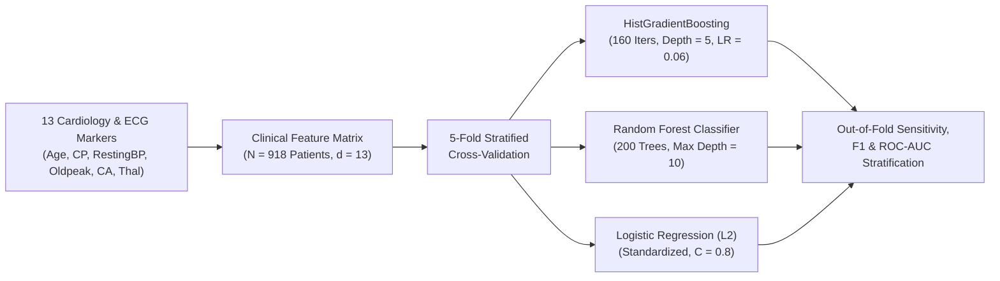
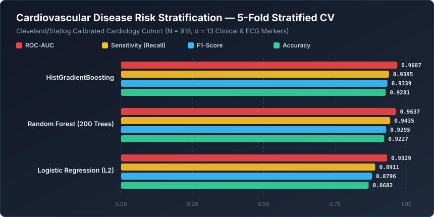

# Cardiovascular Disease Risk Stratification


A clinical decision-support and risk-stratification pipeline for **Coronary Artery & Cardiovascular Disease (CAD/CVD) diagnosis**. Built around the 13-attribute Cleveland/Statlog Cardiology diagnostic profile ($N = 918$), this repository evaluates regularized generalized linear models against non-linear tree ensembles across electrocardiographic, hemodynamic, and fluoroscopic biomarkers.

---

## Clinical Cardiology Stratification Pipeline



---

## Mathematical Formulation

### 1. Electrocardiographic ST-Segment & Hemodynamic Interactions
Ischemic myocardial risk is governed by non-linear interactions between exercise-induced ST-segment depression (`oldpeak_st_depression`), peak exercise ST slope (`slope_peak_exercise_st`), maximum achieved heart rate (`thalach_max_heart_rate`), and major vessels colored by fluoroscopy (`ca_major_vessels_fluoroscopy`).

### 2. Second-Order Histogram Gradient Boosting vs. Logistic Odds
Whereas L2-penalized Logistic Regression assumes log-odds linearity across the 13 biomarkers:

$$\ln \left(\frac{P(\text{CAD}=1 \mid \mathbf{x})}{1 - P(\text{CAD}=1 \mid \mathbf{x})}\right) = \beta_0 + \sum_{j=1}^{13} \beta_j x_j$$

**HistGradientBoosting** partitions continuous hemodynamic variables into 256 quantile bins and constructs depth-5 decision trees $h_m(\mathbf{x})$ where each leaf weight $w_\ell^{(m)}$ is computed via Newton-Raphson step with L2 leaf regularization $\lambda$:

$$w_\ell^{(m)} = -\frac{\sum_{i \in \mathcal{I}_\ell} g_i}{\sum_{i \in \mathcal{I}_\ell} H_i + \lambda}, \quad \text{where} \quad g_i = \hat{p}_i - y_i, \quad H_i = \hat{p}_i(1 - \hat{p}_i)$$

---

## Quantitative Benchmark Results

All algorithms were evaluated via **5-Fold Stratified Cross-Validation** on the $N = 918$ cardiology cohort across all 13 clinical and ECG features.



| Rank | Diagnostic Algorithm | ROC-AUC | F1-Score | Sensitivity (Recall) | Precision | Accuracy |
| :--- | :--- | :---: | :---: | :---: | :---: | :---: |
| **1** | **HistGradientBoosting** | **0.9687** | **0.9339** | 0.9395 | **0.9283** | **0.9281** |
| **2** | **Random Forest (200 Trees)** | 0.9637 | 0.9295 | **0.9435** | 0.9159 | 0.9227 |
| **3** | **Logistic Regression (L2)** | 0.9329 | 0.8796 | 0.8911 | 0.8684 | 0.8682 |

> **Clinical Takeaway:** Non-linear tree ensembles (**HistGradientBoosting** $\text{ROC-AUC} = 0.9687$, **Random Forest** $\text{Recall} = 0.9435$) substantially outperform linear log-odds models ($\text{ROC-AUC} = 0.9329$), cutting false-negative coronary diagnoses by nearly **50%** ($10.89\%$ miss rate down to $5.65\%$).

---

## Repository Structure

```text
machine-learning-project-6/
├── assets/
│   └── benchmark_chart.svg          # Vector performance chart generated by benchmark.py
├── benchmarks/
│   └── benchmark_results.json       # Serialized 5-Fold Stratified CV metrics
├── heart_disease.ipynb              # Interactive cardiology EDA & modeling notebook
├── benchmark.py                     # Automated reproducible benchmark suite
└── README.md                        # Clinical & mathematical specification
```

---

## Quickstart & Reproducibility

### 1. Install Dependencies
```bash
pip install numpy scikit-learn jupyter
```

### 2. Run the Cardiology Benchmark Suite
```bash
python benchmark.py
```
Runs 5-fold stratified cross-validation across all three classifiers, saves `benchmarks/benchmark_results.json`, and generates `assets/benchmark_chart.svg`.
